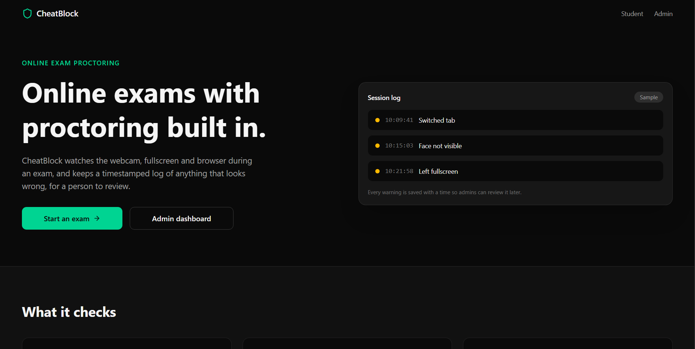
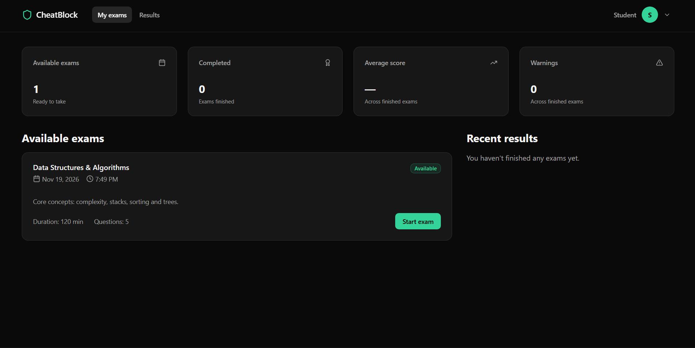
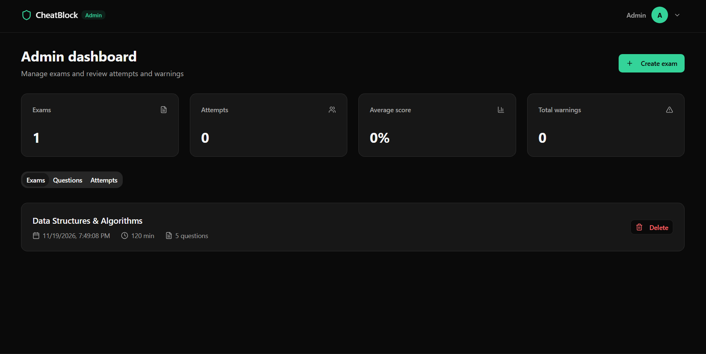

# CheatBlock


An online exam platform with **browser-based proctoring**. Students take timed multiple-choice exams while the browser watches for signs of cheating. Admins create exams and review scores and warning logs.

## Screenshots



| Student dashboard | Admin dashboard |
|---|---|
|  |  |

## Features

### Students
- Sign in, see available exams, and take each exam once.
- Pre-exam check: camera test and exam rules.
- Server-driven timer that can't be stalled by slowing the browser.
- Question navigator, flag-for-review, and a live warning log.
- Score is calculated on the server, never in the browser.
- Results page with analytics charts.

### Proctoring (runs in the browser)
- **Face check** with MediaPipe: no face, or more than one face, for 4 seconds is logged.
- Logs tab switch, window blur, leaving fullscreen, and camera loss.
- Blocks copy, cut, paste, right-click, and common shortcuts.
- **5 warnings auto-submit** the exam.
- Only a timestamped log is stored. **Camera images are never saved.**

### Admins
- Create and delete exams; add, edit, and delete questions.
- View every attempt with its score and warning count.
- Open the full warning log for each attempt.

### Server rules
- One attempt per student per exam.
- Scheduled exams can't be started early.
- A submit arriving more than 60 seconds after the time limit scores 0.

## Tech Stack

| Layer | Tools |
|---|---|
| Client | React 18, Vite, TypeScript, Tailwind CSS 4, shadcn/ui (Radix), Recharts |
| Proctoring | `@mediapipe/tasks-vision` |
| Server | Node 24, Express 5, SQLite (`node:sqlite`) |
| Auth | scrypt password hashes, HMAC-signed HTTP-only session cookie (8 hours) |

## Live Demo

**Try it without installing:** LIVE_DEMO_URL_HERE

Sign in with the live demo accounts in the table under [Demo accounts](#demo-accounts) (`student@cheatblock.local` / `student1234`, or `admin@cheatblock.local` / `admin1234`). The camera needs HTTPS and your permission. The demo data resets when the server restarts.

## Getting Started

**Requirements:** Node **24 or newer**, and [pnpm](https://pnpm.io/).

```bash
git clone https://github.com/Hahashul/CheatBlock.git
cd CheatBlock
```

### 1. Server

```bash
cd server
pnpm install
```

Create `server/.env` (it is git-ignored):

```
PORT=3001
SESSION_SECRET=<a long random string>
```

Generate a secret:

```bash
node -e "console.log(require('crypto').randomBytes(32).toString('hex'))"
```

Start it:

```bash
pnpm dev
```

The database `cheatblock.db` is created on first run and filled with demo data.

### 2. Client (in a second terminal)

```bash
cd client
pnpm install
pnpm dev
```

Open http://localhost:5173. The Vite dev server proxies `/api` to port 3001.

### Demo accounts

| Role | Email | Password (local) | Password (live demo) |
|---|---|---|---|
| Admin | `admin@cheatblock.local` | `admin123` | `admin1234` |
| Student | `student@cheatblock.local` | `student123` | `student1234` |

To reset data: stop the server, delete `server/cheatblock.db`, start again.

> Run every `pnpm` command inside `client/` or `server/`, never in the repo root.

## Environment Variables (server)

| Variable | Purpose |
|---|---|
| `PORT` | Port to listen on (default `3001`) |
| `SESSION_SECRET` | Secret for signing cookies. **Required.** |
| `DATABASE_PATH` | Database file (default `cheatblock.db`) |
| `NODE_ENV` | Set to `production` to make cookies `secure` |
| `ADMIN_PASSWORD`, `STUDENT_PASSWORD` | Demo account passwords. **Required in production.** |

## Deployment

The server also serves the built client, so one service is enough (one URL, no CORS).

- **Build:** `npm install -g pnpm && cd client && pnpm install && pnpm build && cd ../server && pnpm install`
- **Start:** `cd server && node src/index.js`
- **Environment:** `NODE_VERSION=24`, `NODE_ENV=production`, `SESSION_SECRET`, `ADMIN_PASSWORD`, `STUDENT_PASSWORD`
- Must be served over **HTTPS** for the camera to work.

SQLite is a file. On hosts with a temporary disk (e.g. free plans), data resets on restart. For real use, attach a persistent disk and set `DATABASE_PATH`.

## API

All routes are under `/api`.

| Method | Endpoint | Access | Notes |
|---|---|---|---|
| GET | `/health` | public | Server check |
| POST | `/auth/login` | public | `{ email, password }`, sets cookie |
| POST | `/auth/logout` | public | Clears cookie |
| GET | `/auth/me` | signed in | Current user |
| GET | `/exams` | signed in | List with question counts |
| GET | `/exams/:id` | signed in | Exam and questions, without answers |
| GET | `/completed-exams` | student | Ids of submitted exams |
| POST | `/attempts` | student | `{ examId }`. Starts or resumes an attempt |
| POST | `/attempts/:id/violations` | student | `{ type, detail }` |
| POST | `/attempts/:id/submit` | student | `{ answers }`. Scored on the server |
| GET | `/results` | signed in | The caller's finished attempts |
| POST, PUT, DELETE | `/admin/exams`, `/admin/exams/:id` | admin | Manage exams |
| GET, POST | `/admin/exams/:id/questions` | admin | Questions (with answers) |
| PUT, DELETE | `/admin/questions/:id` | admin | Manage a question |
| GET | `/admin/attempts` | admin | All attempts |
| GET | `/admin/attempts/:id/violations` | admin | Warning log for one attempt |

Violation types: `tab_switch`, `window_blur`, `fullscreen_exit`, `camera_lost`, `no_face`, `multiple_faces`.

## Project Structure

```
client/                     React app (Vite)
  src/app/components/       Landing, Login, StudentDashboard, PreExamCheck,
                            ExamInterface, ResultsAnalytics, AdminDashboard
  src/app/api.ts            fetch helper
  src/app/auth.tsx          sign-in state
server/                     Express API
  src/index.js              app, login, serves the client
  src/exams.js              exams, attempts, violations, submit
  src/admin.js              results and admin routes
  src/auth.js               passwords, sessions, role checks
  src/db.js                 SQLite schema
  src/seed.js               demo data
```

## Limitations

Browser proctoring is a **deterrent and evidence log, not a guarantee**.

- It can be bypassed (second device, virtual camera, developer tools, person off camera).
- A web page can't block `Alt+Tab`, `Ctrl+T`, `Ctrl+W`, or the browser menu.
- Face detection can give false alarms (poor light, leaving the frame) and can miss things.
- The warning log is for human review. It is not proof of cheating.
- Warnings are sent by the browser, so the server trusts them as sent.

## Roadmap

- [ ] Rate limiting on login
- [ ] Server-side session revocation
- [ ] Automated tests
- [ ] Bundle the face model for offline use
- [ ] CSV export of results

## Notes

- **Face model:** loads from a Google Storage URL when an exam starts, so students need internet. For offline use, download the `.tflite` file into `client/public/` and update `modelAssetPath` in `ExamInterface.tsx`.
- **WASM files:** MediaPipe engine files live in `client/public/mediapipe/wasm/`. After upgrading `@mediapipe/tasks-vision`, copy them again from `node_modules/@mediapipe/tasks-vision/wasm`.
- **Warning limit:** change `VIOLATION_LIMIT` at the top of `ExamInterface.tsx`.

## Author

**Harshul Adwani** — [GitHub](https://github.com/Hahashul)

## License

Released under the [MIT License](LICENSE).

The interface started from a frontend-only Figma Make export. See [ATTRIBUTIONS.md](ATTRIBUTIONS.md) for third-party components and assets.